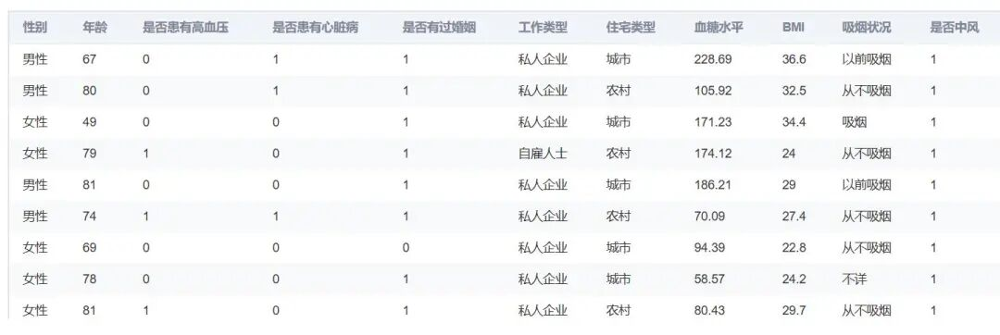

# [Dataset] Stroke Patient Data Set

Background Description: A stroke is a medical condition caused by insufficient blood flow to cells. There are two main types of strokes: ischemic (caused by lack of blood flow) and hemorrhagic (caused by bleeding).

## **Background Description**

Stroke is a medical condition caused by insufficient blood flow to cells. There are two main types of stroke: **ischemic stroke** (caused by lack of blood flow) and **hemorrhagic stroke** (caused by bleeding). Both can lead to the cessation of normal functioning in certain parts of the brain.

Symptoms and signs of stroke may include inability to move or feel one side of the body, difficulty understanding or speaking, dizziness, or loss of vision in one eye. These symptoms and signs usually appear shortly after a stroke occurs.
If the symptoms persist for less than one hour, it is a transient ischemic attack (TIA), also known as a minor stroke.
Hemorrhagic stroke can also be accompanied by severe headaches. The symptoms of stroke may be permanent. Long-term complications may include pneumonia and urinary incontinence.

The primary risk factors for stroke are **hypertension**.
Other risk factors include **high blood cholesterol, smoking, obesity, diabetes, previous TIA, end-stage renal disease, and atrial fibrillation**.

Ischemic strokes are typically caused by vascular obstructions, although there are also less common causes.
Hemorrhagic strokes occur when blood directly enters the brain or spaces between the brain membranes.

Bleeding may be caused by aneurysmal rupture of the cerebral artery. Diagnosis is generally based on physical examination and supplemented with medical imaging, such as CT scans or MRI scans.
CT scans can rule out bleeding but not necessarily ischemic conditions, and early CT scans often do not show ischemia. Other tests, such as an electrocardiogram (ECG) and blood tests, are used to identify risk factors and rule out other potential causes. Hypoglycemia can also cause similar symptoms.

## **Data Description**

-

BMI classification of the "China Adult Overweight and Obesity Prevention and Control Guidelines"

|

BMI

 ||

Body Mass Index Explanation

 |

|

< 18.5

 ||

Underweight

 |
|

18.5 - 23.9

 ||

Normal weight

 |
|

24 - 27.9

 ||

Overweight

 |
|

> 28

 ||

Obesity

 |

-

Glucose level
The expected range for normal fasting blood glucose concentration is between 70 mg/dL and 100 mg/dL.

>

3.9 mmol/L and 5.6 mmol/L

## **Problem Description**

Stroke patient data EDA
Stroke prediction analysis

Dataset screenshot:

## Payment

Here is a pay link on Stripe ( https://buy.stripe.com/3cs8yP7sY87d0vu9AB ). Please contact me lonlonago@foxmail.com after funding $89, and I will send you a complete data files , thank you!

